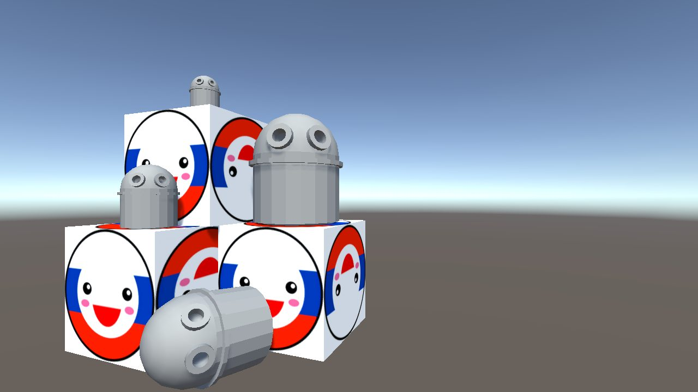
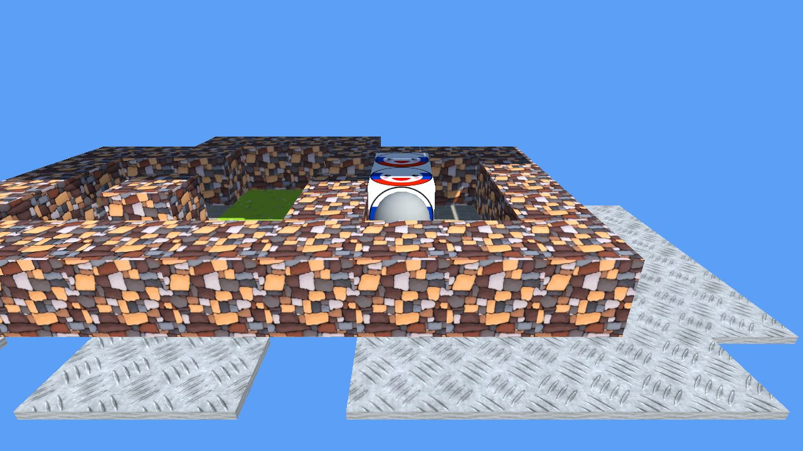
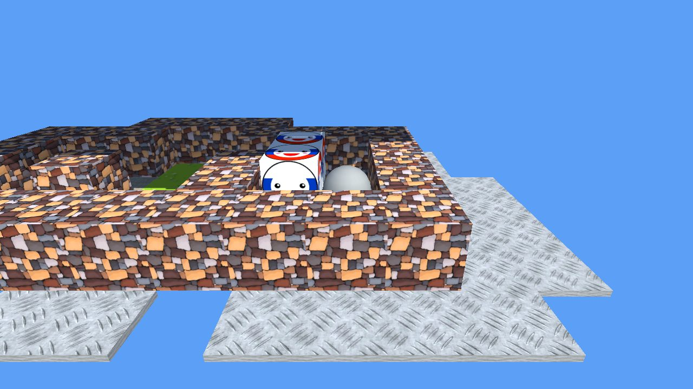
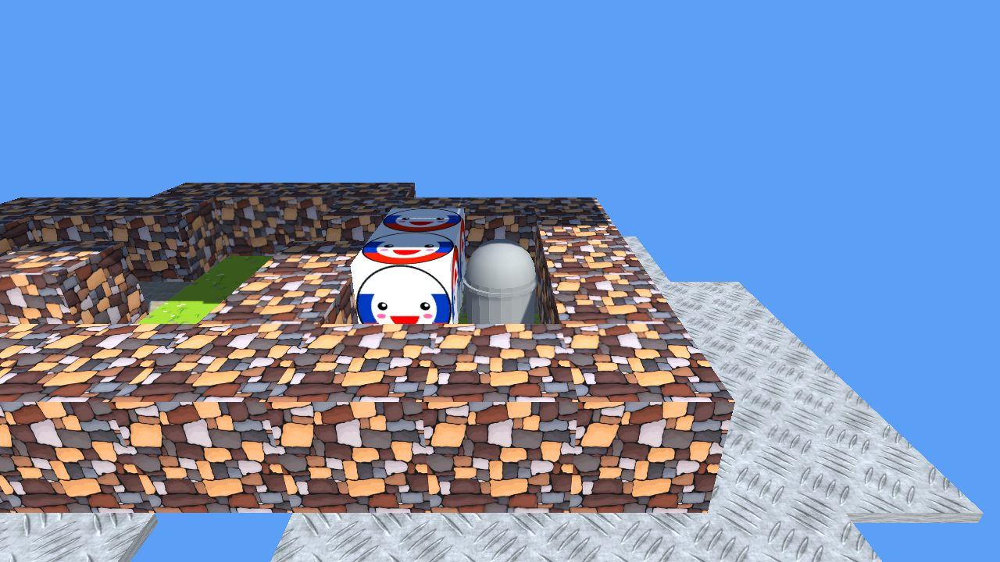
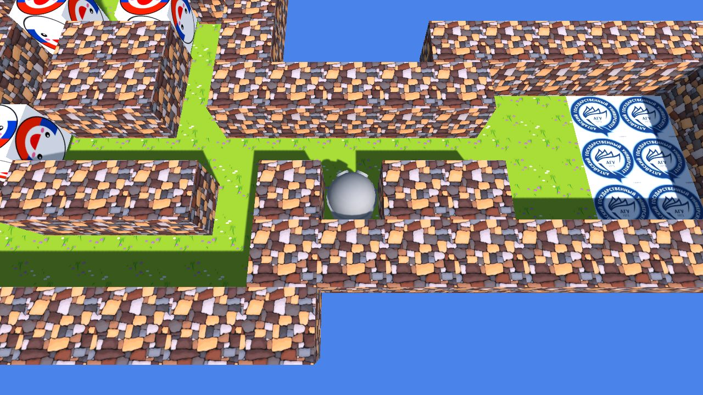
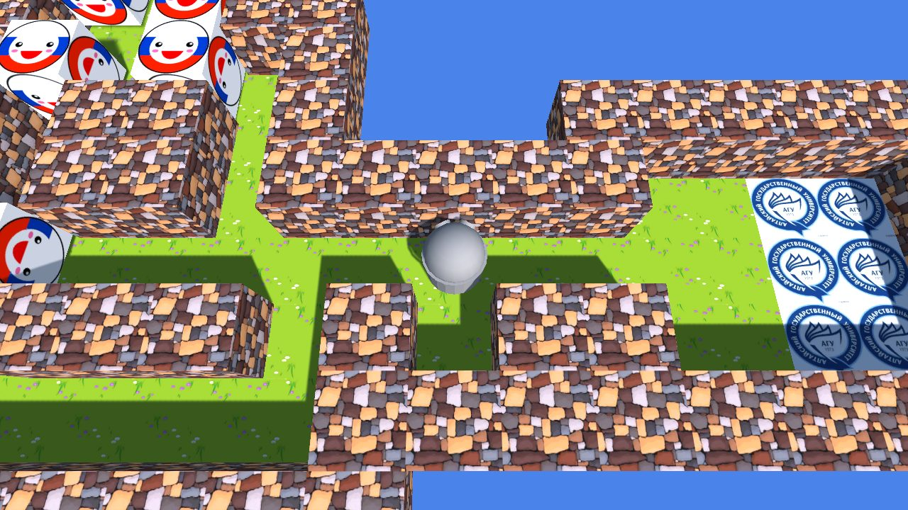
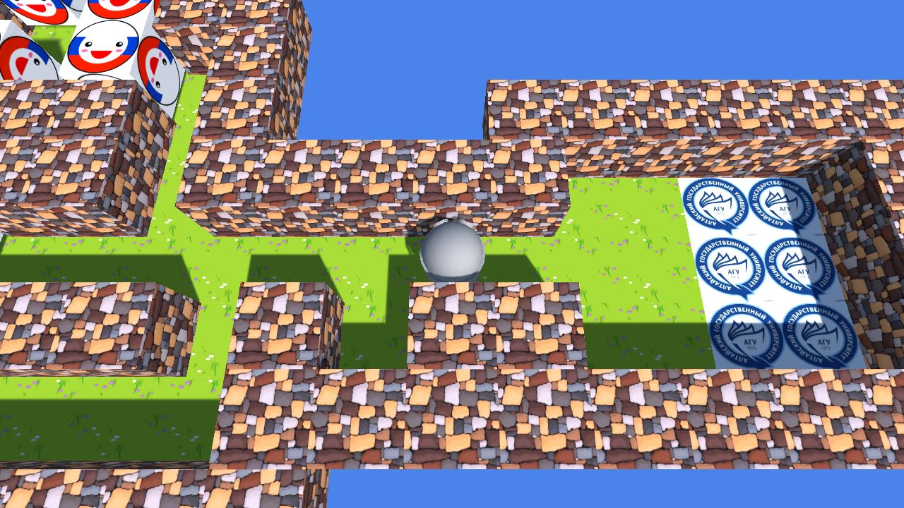
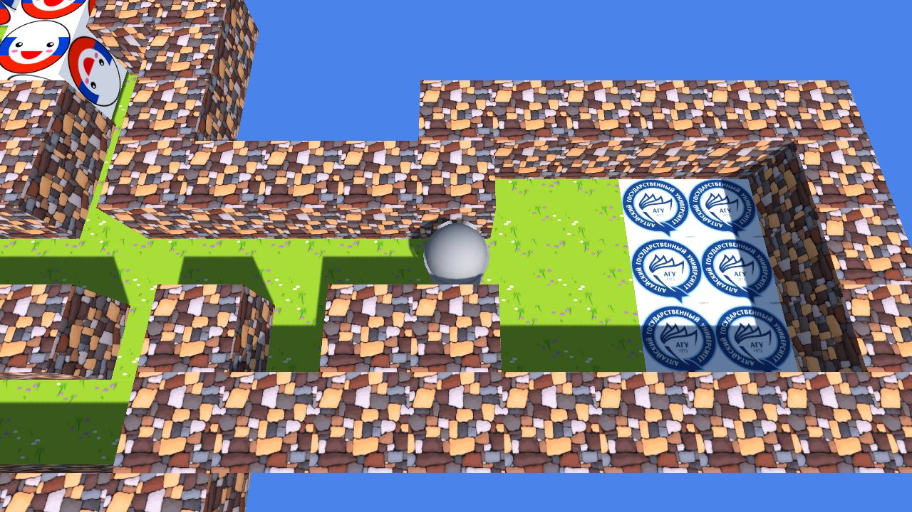

# Unity 3D 推箱子游戏

大学课程作业做的 Unity 小游戏，把经典的推箱子玩法搬到了 3D 场景里，又加了一些自己的东西：场景里有会动的机器人，会朝玩家开枪，得躲着走；还有升降梯、滑梯、移动平台这些机关，要掐着时机通过。用 Unity 2019.4 做的，脚本是 C#。

玩法上，方向键控制角色移动，碰到箱子可以往前推，把箱子推到目标点上就算完成。移动和推箱子都是射线检测实现的：先朝移动方向打一条射线，没撞到东西就走一格，撞到的是箱子就尝试推，箱子前面也被挡住就推不动。关卡是用文本地图配置的，改几个字符就能调整墙体和箱子的位置，做新关卡很方便。

游戏有完整的开始菜单、关卡选择和通关结算流程，通关后会统计步数。下面这组图是游戏实际运行时的画面，按操作过程截的：从开始界面进关卡，一步步移动、推箱子、被墙挡住，相机视角就是游戏里跟随玩家的那台相机。

